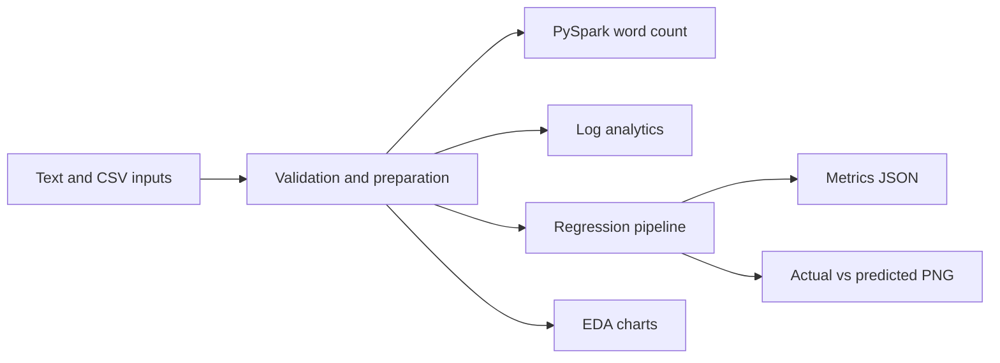
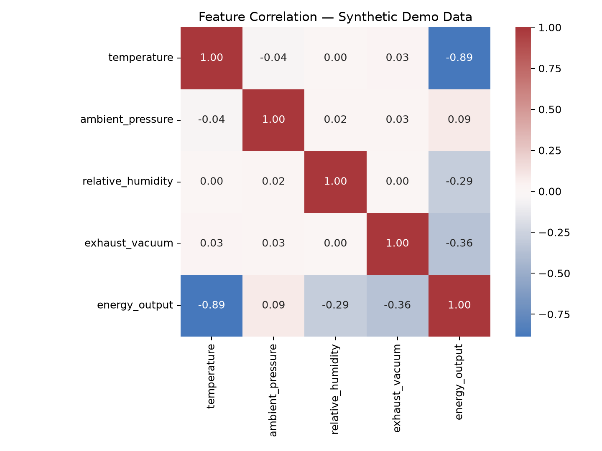
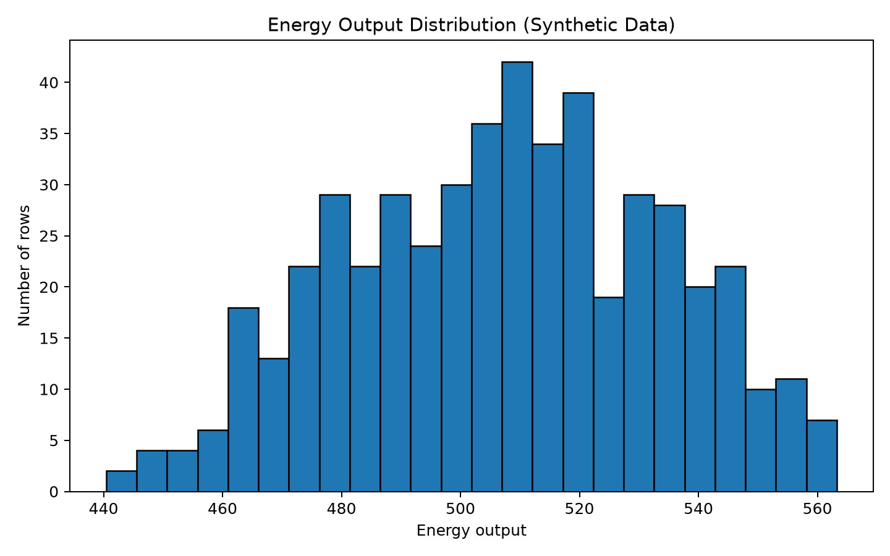
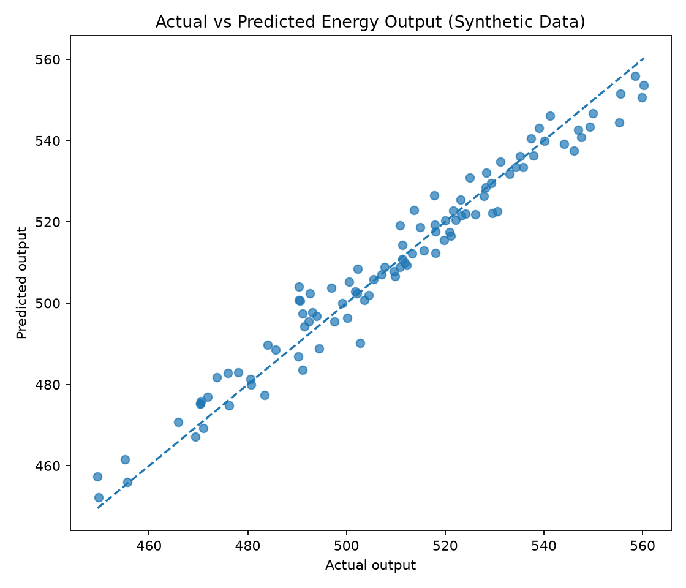

# Big Data & ML Pipeline: PySpark, Log Analytics and Regression

[](https://colab.research.google.com/github/harpreetsingh171190-cmyk/professional-portfolio-colab/blob/main/professional_portfolio_colab.ipynb)
[](https://www.python.org/)
[](LICENSE)

A reproducible portfolio project covering synthetic data generation, distributed word count with **PySpark**, web-server **log analytics**, a **regression model** evaluated on held-out data, and automatic chart generation. Everything runs end-to-end in Google Colab or locally.

> **Data disclaimer:** The power-plant-like dataset is synthetic and created for educational demonstrations. Model metrics describe only this generated sample and must not be interpreted as real industrial performance.

## Highlights

- **Synthetic data** – deterministic datasets (fixed seed `4651`), so results are the same on every run.
- **Distributed computing** – word count with PySpark.
- **Log analytics** – requests, bytes and status codes per path; malformed lines are counted, not crashed on.
- **Machine learning** – Random Forest regression with a train/test split and MAE, RMSE and R² metrics.
- **Visualisation** – correlation heatmap, target distribution and actual-vs-predicted chart.
- **Quality** – unit tests for the log parser, a GitHub Actions workflow and a `Makefile`.

**Tech stack:** `Python` · `PySpark` · `Pandas` · `NumPy` · `Matplotlib` · `Seaborn` · `scikit-learn` · `pytest` · `Google Colab`

## Pipeline



## Results

Random Forest (160 trees) predicting `energy_output` from temperature, ambient pressure, relative humidity and exhaust vacuum. 400 rows for training, 100 for testing.

| Metric | Value |
|--------|-------|
| MAE | 4.08 |
| RMSE | 5.07 |
| R² | 0.963 |

Log analysis of the sample `access.log`: **250 valid requests, 0 invalid lines**.

> **Read the numbers carefully:** the target is generated from a linear formula plus random noise, so a high R² is expected. It shows that the pipeline works, not that the model would perform this well on real data.

### Visualisations

**Correlation heatmap**


**Energy output distribution**


**Actual vs. predicted values**


## Getting Started

### Option 1: Google Colab (easiest)

Click the **Open in Colab** badge above and run all cells. The notebook creates the project, generates the data, runs analysis, charts, ML and tests, and offers the result as a ZIP download. The PySpark cell needs Java and may be skipped on some runtimes; everything else still runs.

### Option 2: Run locally

Python 3.10–3.12 is recommended, and Java 11 or 17 is needed for PySpark.

```bash
git clone https://github.com/harpreetsingh171190-cmyk/professional-portfolio-colab.git
cd professional-portfolio-colab

python -m venv .venv
source .venv/bin/activate          # Windows PowerShell: .venv\Scripts\Activate.ps1
pip install -r requirements.txt

python -m src.generate_data
python -m src.word_count --input data/sample_text.txt --output outputs/word_count
python -m src.log_analysis --input data/access.log --output outputs/log_summary.csv
python -m src.visualize --input data/power_plant.csv --output-dir outputs/charts
python -m src.ml_pipeline --input data/power_plant.csv --output-dir outputs/ml
pytest -q
```

Shortcuts are available through `make install`, `make data`, `make charts`, `make model` and `make test`.

## Project Structure

```text
professional-portfolio-colab/
├── professional_portfolio_colab.ipynb   # Colab notebook that runs everything
├── charts/                              # Chart images shown in this README
├── data/                                # Synthetic datasets and sample access log
├── docs/                                # Platform setup and project notes
├── outputs/                             # Generated results (git-ignored)
├── prompts/                             # Optional prompts for AI-generated illustrations
├── src/                                 # Data, Spark, log analysis, ML and plotting scripts
├── tests/                               # Unit tests
├── .github/workflows/                   # CI checks
├── Makefile
├── requirements.txt
├── LICENSE
└── README.md
```

## Possible Next Steps

- [ ] Add a plain Linear Regression baseline and compare it with the Random Forest.
- [ ] Add tests for the ML pipeline and the data generator.
- [ ] Try the pipeline on a real public dataset, such as the UCI Combined Cycle Power Plant data.
- [ ] Show the word-count output in the README.

## License

Released under the [MIT License](LICENSE).

## Author

**Harpreet (Hunny)** · [GitHub: harpreetsingh171190-cmyk](https://github.com/harpreetsingh171190-cmyk)
